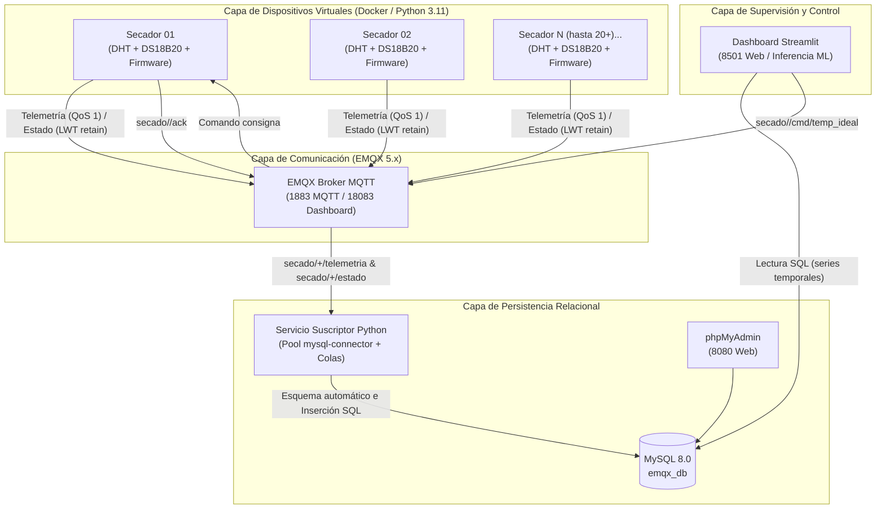

# Sistema de Simulación y Virtualización IoT de Secadores de Café/Cacao bajo MQTT

> **Punto 3 del Trabajo Práctico:** Avance de simulación (virtualización) de varios sensores en entorno de red bajo MQTT.  
> Demostración de escalabilidad multi-secador mediante virtualización por software sin requerir adquisición de hardware adicional.

---

## ⚠️ Aviso de Migración y Deprecación
El stack anterior ubicado en la subcarpeta `emqx_mysql_stack/` queda **obsoleto**. Toda la infraestructura, base de datos, simulación, suscriptor y panel de visualización han sido unificados en la raíz del proyecto (`IOT_Trabajo/docker-compose.yml`) bajo una única red bridge `emqxnet` y configuración centralizada en `.env`.

---

## 1. Arquitectura del Sistema



---

## 2. Diseño de Tópicos y Formato de Mensajes

Todos los payloads se envían codificados en **UTF-8** utilizando formato estándar **JSON** (excepto `estado` con texto plano compatible con LWT).

| Tópico | Dirección | QoS | Retain | Formato Payload | Descripción |
| :--- | :---: | :---: | :---: | :--- | :--- |
| `secado/<id_secador>/telemetria` | Pub (Simulador) | 1 | No | JSON | Publicación periódica (cada 2 s) de lecturas de sensores (DHT, DS18B20) y actuadores (LED, PWM). |
| `secado/<id_secador>/estado` | Pub (Simulador / Broker) | 1 | **Sí** | Texto (`online` / `offline`) | Estado de conectividad de cada secador. Configurado como Last Will and Testament (LWT) en el broker. |
| `secado/<id_secador>/cmd/temp_ideal` | Sub (Simulador) | 1 | No | Numérico o JSON | Consigna de temperatura ideal (rango 10.0–50.0 °C) enviada por el operador o modelo de ML. |
| `secado/<id_secador>/ack` | Pub (Simulador) | 1 | No | JSON | Confirmación instantánea de aceptación (`ok`) o rechazo (`error`) de la consigna. |

### Ejemplos de Payloads

#### Telemetría (`secado/secador_01/telemetria`):
```json
{
  "id": "secador_01",
  "ts": "2026-10-05T12:26:20.565Z",
  "t_amb": 28.26,
  "hum": 63.97,
  "t_grano": 38.06,
  "t_ideal": 38.00,
  "led": "V",
  "ventilador_pwm": 0
}
```

#### Estado con Last Will (`secado/secador_01/estado`):
```text
online
```
*(Si el secador sufre una caída de red o corte abrupto, el broker publica inmediatamente `offline` a todos los suscriptores).*

#### Comando de Consigna (`secado/secador_01/cmd/temp_ideal`):
```text
42.5
```

#### Confirmación ACK (`secado/secador_01/ack`):
```json
{
  "secador_id": "secador_01",
  "status": "ok",
  "t_ideal": 42.5,
  "ts": "2026-10-05T12:28:10.120Z",
  "mensaje": "Consigna actualizada exitosamente"
}
```

---

## 3. Lógica de Control y Modelo Físico

El simulador replica con exactitud milimétrica las reglas embebidas del firmware en Arduino Nano:
- **Diferencia térmica:** $\Delta = |T_{grano} - T_{ideal}|$
  - $\Delta \le 0.8\ ^\circ\text{C} \implies$ **LED Verde (`V`)**, Ventilador **0 PWM (0 %)**
  - $0.8 < \Delta \le 2.2\ ^\circ\text{C} \implies$ **LED Amarillo (`A`)**, Ventilador **153 PWM (60 %)**
  - $\Delta > 2.2\ ^\circ\text{C} \implies$ **LED Rojo (`R`)**, Ventilador **255 PWM (100 %)**
- **Modelo térmico de 1er orden:** Ecuación diferencial discretizada con inercia térmica $\alpha$, disipación asistida proporcional al ventilador PWM y deriva ambiental estocástica (sensor DHT) con ruido gaussiano $\mathcal{N}(0, \sigma^2)$.
- **Modo seguro ante fallas de hardware:** Detección de lecturas anómalas del sensor DS18B20 (`85.0 °C` por reset de encendido o `-127.0 °C` por desconexión del bus 1-Wire). Ante cualquier valor anómalo, el secador conmuta a modo de protección térmica: **LED Rojo (`R`)** y **Ventilador al 100 % (255 PWM)**.

---

## 4. Puesta en Marcha en UN Solo Comando

Desde la carpeta raíz `IOT_Trabajo`:

```bash
docker compose up -d --build
```

### ¿Qué ocurre automáticamente sin pasos manuales?
1. Se crea la red bridge `emqxnet` y el volumen nombrado para MySQL.
2. Inician `emqx` (puertos 1883, 18083) y `mysql` (puerto 3306).
3. MySQL ejecuta automáticamente el esquema `simulacion_mqtt/schema.sql` montado en `/docker-entrypoint-initdb.d/`.
4. El mecanismo de `healthcheck` de Docker aguarda a que EMQX y MySQL respondan positivamente.
5. Inician `phpmyadmin` (8080), el `suscriptor` (que asegura de forma idempotente las tablas en MySQL) y el `dashboard` Streamlit (8501).
6. Inicia el `simulador`, arrancando de forma escalonada los $N$ secadores virtuales.

### URLs de Acceso Inmediato:
- **Dashboard Streamlit:** [http://localhost:8501](http://localhost:8501) (Monitoreo gráfico en tiempo real y ajuste de consigna).
- **phpMyAdmin:** [http://localhost:8080](http://localhost:8080) (Usuario: `emqx_user`, Clave: `emqx_pass`, BD: `emqx_db`).
- **EMQX Dashboard:** [http://localhost:18083](http://localhost:18083) (Usuario: `admin`, Clave: `public`).

---

## 5. Escalado y Operación de la Flota

Toda la configuración está centralizada en el archivo `.env` en la raíz:

### Para escalar el número de secadores (ej. de 5 a 20 secadores):
1. Edite `.env`:
   ```ini
   N_SECADORES=20
   ```
2. Ejecute en la raíz:
   ```bash
   docker compose up -d
   ```
   Docker Compose detecta el cambio únicamente en el servicio `simulador` y recrea su contenedor en caliente, manteniendo la base de datos, el broker y el dashboard funcionando sin interrupción.

### Para detener el sistema de forma limpia (preservando datos y volúmenes):
```bash
docker compose down
```

---

## 6. Modelo de Datos Relacional vs. No Relacional

### 6.1 Modelo Relacional Implementado (MySQL 8.0)
El archivo `schema.sql` define:
- `secadores`: Catálogo de secadores registrados (`id`, `nombre`, `ubicacion`, `creado_en`).
- `lecturas`: Series temporales de telemetría (`id`, `secador_id`, `ts DATETIME(3)`, `t_amb`, `hum`, `t_grano`, `t_ideal`, `led`, `ventilador_pwm`).
  - Cuenta con índice compuesto `(secador_id, ts)` para acelerar consultas analíticas y filtrado temporal.
- `eventos_estado`: Registro de auditoría de conectividad (`online`/`offline`) con timestamp de alta precisión.

### 6.2 Propuesta y Justificación del Modelo No Relacional (MongoDB / Redis)
En un escenario industrial de gran escala ($>10,000$ unidades sensoras con telemetría cada 100 ms):

1. **MongoDB Time-Series Collection:**
   ```javascript
   db.createCollection("telemetria_secadores", {
     timeseries: {
       timeField: "ts",
       metaField: "secador_id",
       granularity: "seconds"
     }
   });
   ```
   - **Documento JSON:**
     ```json
     {
       "ts": ISODate("2026-10-05T12:26:20.565Z"),
       "secador_id": "secador_01",
       "t_amb": 28.26,
       "hum": 63.97,
       "t_grano": 38.06,
       "t_ideal": 38.00,
       "actuadores": { "led": "V", "ventilador_pwm": 0 }
     }
     ```
   - **Justificación:** Ingesta masiva sin bloqueos de clave externa, compresión columnar nativa (zstd) que ahorra hasta un 70 % de almacenamiento y flexibilidad de esquema (*schema-less*) si se incorporan sensores de CO₂ o presión.

2. **Redis TimeSeries (Edge / Fog Computing):**
   ```text
   TS.ADD secado:secador_01:t_grano * 38.06 RETENTION 86400000
   ```
   - **Justificación:** Operación en memoria RAM con latencia submilimétrica para alarmas instantáneas y pre-filtrado en el nodo de borde antes del broker central.

---

## 7. Despliegue en Ubuntu / VirtualBox (Guía de Laboratorio)

El diseño está 100 % desacoplado del sistema operativo host (Windows, Linux, macOS). Para ejecutar este mismo proyecto en una máquina virtual **Ubuntu Server / Desktop en VirtualBox**:

1. Instalar Docker y Docker Compose en Ubuntu:
   ```bash
   sudo apt-get update
   sudo apt-get install -y docker.io docker-compose-v2
   sudo usermod -aG docker $USER
   # Cerrar e iniciar sesión de nuevo
   ```
2. Clonar o copiar la carpeta `IOT_Trabajo` a la máquina virtual:
   ```bash
   cd ~/IOT_Trabajo
   ```
3. Ejecutar exactamente el mismo comando:
   ```bash
   docker compose up -d --build
   ```
   Todos los servicios levantarán con los mismos puertos y configuraciones sin requerir ninguna modificación.

---

## 8. Qué Mostrar en la Presentación Académica (Checklist Demo)

1. **EMQX Dashboard (`http://localhost:18083`):**
   - Ir a la pestaña **Clients**: Mostrar los 5 (o 20) clientes virtuales `sim_secador_01` a `sim_secador_N` y el cliente persistente `suscriptor_bd_1` conectados en vivo.
   - Ir a **Subscriptions**: Mostrar la suscripción wildcard `secado/+/telemetria`.
2. **Base de Datos MySQL en phpMyAdmin (`http://localhost:8080`):**
   - Abrir la base de datos `emqx_db` y la tabla `lecturas`.
   - Mostrar cómo los registros ingresan cada 2 segundos con `ts` crecientes, sin nulos y con la lógica LED/PWM correspondiente.
   - Ejecutar la consulta de conteo:
     ```sql
     SELECT secador_id, COUNT(*) AS lecturas, MAX(ts) FROM lecturas GROUP BY secador_id;
     ```
3. **Panel Interactivo Streamlit (`http://localhost:8501`):**
   - Mostrar el gráfico térmico en vivo ($T_{grano}$ vs. $T_{ideal}$).
   - Mover el slider de consigna a `44.0 °C` y hacer clic en **Enviar Nueva Consigna**.
   - Mostrar cómo el secador responde con confirmación ACK en tiempo real y cómo los actuadores ajustan el ventilador PWM a 153 o 255.
4. **Resiliencia y Last Will and Testament (LWT):**
   - Mostrar que al reiniciar el broker (`docker compose restart emqx`) o detener un secador, el suscriptor y simulador se reconectan automáticamente sin perder la persistencia en MySQL.
